# Лабораторная работа №2: Модели. CRUD

**Студент:** Ануфриев Владислав Денисович
**Группа:** ПИЖ-б-о-25-2
**Технология:** Python + Django
**Вариант:** 2 — Каталог товаров

---

## Цель работы

Изучить модели Django, их поля и параметры, освоить механизм миграций и ORM. Научиться выполнять операции CRUD через консоль Django shell на примере модели `Product` (каталог товаров).

## Задание

Создать модель `Product` со следующими полями:

- `name` — название товара (строка, до 150 символов);
- `price` — цена (десятичное число);
- `description` — описание (текст, необязательное);
- `in_stock` — наличие (логическое, по умолчанию `True`);
- `created_at` — дата создания (автоматически);
- `quantity` — количество (целое, по умолчанию 1).

Написать метод `__str__`, возвращающий название товара. Вывести список товаров дешевле 1000 руб.

---

## Ход работы

### 1. Создание проекта и приложения

Проект создан командами:

```bash
python -m django startproject lab2_web .
python manage.py startapp shop
```

Приложение `shop` добавлено в `INSTALLED_APPS` в файле `settings.py`.

### 2. Модель Product

В файле `shop/models.py` описана модель `Product`:

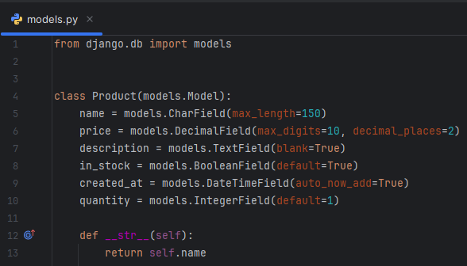

*Рисунок 1 — Модель `Product` в файле `shop/models.py`*

### 3. Миграции

Выполнены команды:

```bash
python manage.py makemigrations
python manage.py migrate
python manage.py showmigrations shop
```

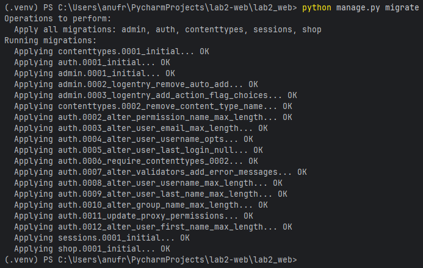

*Рисунок 2 — Применение миграций*

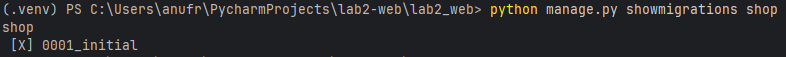

*Рисунок 3 — Проверка применённых миграций*

### 4. Работа с ORM (CRUD)

Все операции CRUD выполнены через консоль Django shell.

#### 4.1. Запуск shell и импорт модели

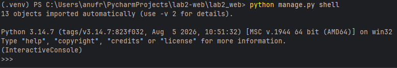

*Рисунок 4 — Запуск консоли Django*

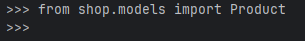

*Рисунок 5 — Импорт модели `Product`*

#### 4.2. Create — создание записей

Создано 7 товаров через `Product.objects.create(...)`.

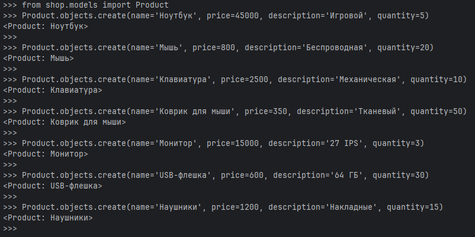

*Рисунок 6 — Создание товаров (Create)*

#### 4.3. Read — чтение записей

**Получение всех записей (`all`):**

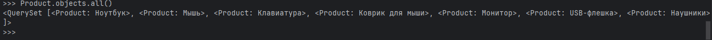

*Рисунок 7 — Получение всех записей (`all()`)*

**Фильтрация товаров дешевле 1000 руб. (главное задание варианта):**

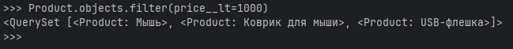

*Рисунок 8 — Товары дешевле 1000 руб. через `filter(price__lt=1000)`*

**Вывод дешёвых товаров в цикле:**

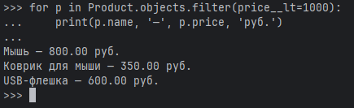

*Рисунок 9 — Вывод дешёвых товаров в цикле*

**Получение одной записи (`get`):**

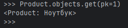

*Рисунок 10 — Получение одной записи по `pk=1`*

**Исключение записей (`exclude`):**

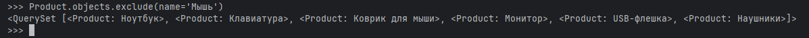

*Рисунок 11 — Исключение записей (`exclude`)*

#### 4.4. Update — обновление записи

Изменена цена товара с `pk=7` с 1200 на 1100 руб.

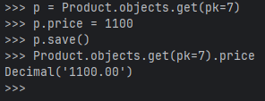

*Рисунок 12 — Обновление цены (Update)*

#### 4.5. Delete — удаление записи

Удалён товар с `pk=7`.

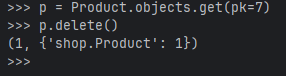

*Рисунок 13 — Удаление записи (Delete)*

Проверка количества оставшихся записей:

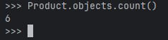

*Рисунок 14 — Проверка количества записей после удаления*

#### 4.6. Выход из консоли

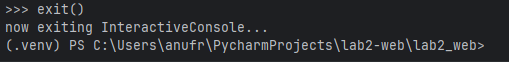

*Рисунок 15 — Выход из консоли Django*

### 5. Просмотр базы данных

Для проверки структуры и данных использован **SQLiteStudio**.

**Структура таблицы `shop_product`:**

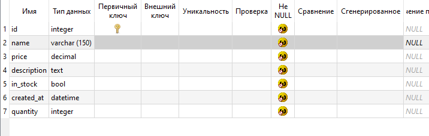

*Рисунок 16 — Структура таблицы `shop_product`*

**Данные таблицы `shop_product`:**

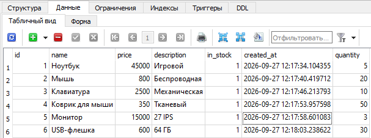

*Рисунок 17 — Данные таблицы `shop_product`*

---

## Ответы на контрольные вопросы

**1. Что такое модель в Django и для чего она используется?**

Модель — это класс Python, наследник `django.db.models.Model`, который описывает структуру таблицы БД. Она представляет слой данных в архитектуре MTV и позволяет работать с БД через ORM без написания SQL.

**2. Какие типы полей вы знаете? Приведите примеры.**

`CharField`, `TextField`, `IntegerField`, `DecimalField`, `DateTimeField`, `BooleanField`, `ImageField`, `EmailField`, `SlugField` и др.

**3. Чем отличаются параметры `blank=True` и `null=True`?**

`blank=True` — поле может быть пустым на уровне валидации форм (в админке, формах).  
`null=True` — в БД может храниться значение `NULL`. Для строковых полей обычно используют только `blank=True`, чтобы не было двух видов «пустоты».

**4. Что такое миграции и зачем они нужны? Опишите основные команды.**

Миграции — это способ Django отслеживать изменения в моделях и применять их к схеме БД.

Основные команды:

- `python manage.py makemigrations` — создать миграции;
- `python manage.py migrate` — применить миграции;
- `python manage.py sqlmigrate <app> <migration>` — показать SQL;
- `python manage.py showmigrations` — список миграций.

**5. Как создать суперпользователя для доступа к административной панели Django?**

```bash
python manage.py createsuperuser
```

Далее ввести имя, email и пароль.

**6. Что такое ORM? Перечислите основные методы для выполнения операций CRUD.**

ORM (Object-Relational Mapping) — прослойка, позволяющая работать с БД через объекты Python.

CRUD:

- **Create:** `Model.objects.create(...)` или `obj = Model(...); obj.save()`
- **Read:** `all()`, `filter()`, `get()`, `exclude()`
- **Update:** изменить атрибуты и вызвать `save()`
- **Delete:** `obj.delete()`

**7. В чем разница между методами `filter()` и `get()`?**

`filter()` возвращает `QuerySet` (может быть 0, 1 или много записей).  
`get()` возвращает один объект; если записей нет или их несколько — выбрасывает исключение (`DoesNotExist` или `MultipleObjectsReturned`).

**8. Как настроить загрузку изображений (медиафайлов) в проекте Django?**

В `settings.py`:

```python
MEDIA_ROOT = os.path.join(BASE_DIR, 'media')
MEDIA_URL = '/media/'
```

В корневом `urls.py` при `DEBUG=True`:

```python
from django.conf import settings
from django.conf.urls.static import static

if settings.DEBUG:
    urlpatterns += static(settings.MEDIA_URL, document_root=settings.MEDIA_ROOT)
```

В модели использовать `ImageField(upload_to='...')` (требуется `Pillow`).

**9. Для чего нужен метод `__str__` в модели?**

Он задаёт строковое представление объекта. Используется в админке, консоли, шаблонах — вместо `<Product: Product object (1)>` будет `<Product: Ноутбук>`.

**10. Что произойдёт, если выполнить `python manage.py makemigrations`, но не выполнить `migrate`?**

Файл миграции будет создан, но изменения не применятся к БД. Таблица/поля в базе не появятся, и при попытке работы с моделью возникнет ошибка.

---

## Вывод

В ходе лабораторной работы изучены модели Django, типы полей и их параметры (`blank`, `null`, `default`, `auto_now_add`, `auto_now`). Создана модель `Product` для каталога товаров, выполнены миграции, таблица `shop_product` появилась в базе данных SQLite. Через консоль Django shell продемонстрированы все операции CRUD: создание 7 товаров, чтение (`all`, `get`, `filter`, `exclude`), обновление цены, удаление записи. Выполнено главное задание варианта — вывод товаров дешевле 1000 руб. через `Product.objects.filter(price__lt=1000)`. Результат подтверждён просмотром структуры и данных таблицы в SQLiteStudio.